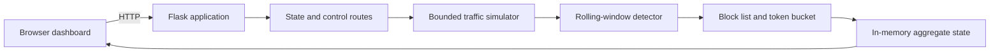

# SENTINEL: A Safe, Explainable, and Interactive Synthetic Traffic Observatory

## IEEE-Style Project Report

**Project type:** Full-stack educational security visualization  
**Implementation:** Python, Flask, HTML, CSS, and JavaScript  
**Execution model:** Bounded, in-memory simulation with optional local CPU/memory telemetry  

## Live Demo

**Open the deployed application:** [sentinel-traffic-observatory.onrender.com](https://sentinel-traffic-observatory.onrender.com/)

The public demo is hosted on Render and serves the Flask application, API, and interactive dashboard. The local URL remains available for development: `http://127.0.0.1:5000`.

---

## Abstract

This project presents **SENTINEL**, an interactive traffic observatory for demonstrating the concepts of burst detection, rate limiting, temporary blocking, and service availability under excessive request conditions. The system is designed as a safe alternative to real traffic-generation or load-testing tools. It produces bounded synthetic events inside a Python process and displays the complete detection and mitigation lifecycle through a dynamic web dashboard.

Unlike a static chart or an opaque machine-learning demonstration, SENTINEL connects a transparent detection engine to an animated operational interface. Users can select normal traffic or an excessive synthetic burst, observe incoming and accepted traffic simultaneously, inspect the exact reason for each classification, and measure the effect of mitigation on simulated service health. No external API, target URL, public IP, packet sender, real user data, or network attack capability is required.

The interface also reads CPU and memory utilization from the machine running Flask. These readings are used only as local context for the observability view; they are never sent outside the application and are not treated as network traffic. The traffic field remains synthetic by design, while its intensity, particles, node activity, core glow, and system indicators now respond to live simulator and local-machine state.

**Keywords:** DDoS education, synthetic traffic, explainable detection, rate limiting, token bucket, Flask, cybersecurity visualization, safe simulation, service availability.

---

## 1. Introduction

Distributed denial-of-service attacks are commonly explained using abstract diagrams or demonstrations that may accidentally encourage unsafe traffic generation. Students often understand the terminology but do not see how a detection threshold, a mitigation decision, and service availability are related over time.

SENTINEL addresses this educational gap with a controlled full-stack simulation. A local Flask service generates synthetic request events, evaluates them using rolling-window thresholds, applies in-memory mitigation policies, and exposes only aggregate state to the browser. The browser renders the state as a visual security operations interface.

The project is intentionally designed for classroom demonstrations, viva presentations, prototyping, and security-concept learning rather than production protection.

## 2. Problem Statement

An educational demonstration of excessive traffic should answer the following questions without interacting with a real service:

1. How can request bursts be detected using understandable rules?
2. How can suspicious sources be temporarily blocked?
3. How does rate limiting affect accepted traffic?
4. How can mitigation impact be measured visually?
5. How can these concepts be demonstrated without sending harmful traffic?

Existing basic demonstrations frequently show only a counter or a chart. They may not explain why an event was classified, how multiple mitigation mechanisms interact, or how safety limits are enforced. SENTINEL combines these elements into one bounded and observable system.

## 3. Objectives

The primary objectives are:

- Generate realistic-looking but entirely synthetic request events.
- Detect source-level and global traffic bursts with transparent thresholds.
- Apply temporary source blocking to suspicious events.
- Apply token-bucket rate limiting to remaining sources.
- Compare traffic before and after mitigation.
- Show availability and capacity indicators in real time.
- Provide exact detection explanations in the interface.
- Keep all processing local, finite, and safe by design.

## 4. System Uniqueness and Innovation

The main contribution of SENTINEL is not a new attack technique. Its contribution is a safer and more explainable way to teach defensive traffic analysis.

### 4.1 Safety-first simulation boundary

The system has no target input, packet transmission, botnet behavior, reflection, amplification, real traffic collection, or public network binding. The simulation is hard-limited to:

- loopback access by default for local execution; Render binds the production process to its assigned port
- 10 seconds per run
- 300 total events
- 60 generated events per second
- in-memory state only

### 4.2 Explainable detection

Every classification includes a human-readable reason, such as:

```text
source rate 6 requests/2s >= 6
```

This makes the result auditable and suitable for teaching. Users can connect a visible dashboard event to the exact rule that produced it.

### 4.3 Dual-layer mitigation

SENTINEL combines two defensive primitives:

1. **Temporary block list:** suspicious sources are blocked for a bounded duration.
2. **Token bucket:** remaining sources are allowed only while tokens are available and are rate limited when tokens are exhausted.

This demonstrates that detection and mitigation are separate stages with different responsibilities.

### 4.4 Operational 3D visualization without a 3D engine

The dashboard uses CSS transforms, animated orbital layers, glowing nodes, scan lines, and a central service core to create a lightweight 3D observability experience. This avoids a large rendering dependency while retaining a visually engaging operations-center interface that can run locally.

### 4.5 Reproducible synthetic data

The simulator uses a seeded random generator. The same scenario logic can therefore be reproduced for demonstrations and testing without collecting or storing real traffic data.

## 5. System Architecture



### 5.1 Backend components

| Component | Responsibility |
|---|---|
| `app.py` | Flask routes, JSON responses, and page rendering |
| `simulator.py` | Synthetic event generation, scenario state, and aggregate history |
| `detector.py` | Source and global rolling-window classification |
| `mitigation.py` | Temporary blocks and token-bucket rate limiting |
| `config.py` | Safety limits, thresholds, capacity, and timing values |

### 5.2 Frontend components

| Component | Responsibility |
|---|---|
| `templates/index.html` | SENTINEL command-center layout |
| `static/style.css` | Responsive visual design and CSS 3D topology |
| `static/dashboard.js` | Polling, controls, canvas chart, feed, and live metrics |

## 6. Methodology

### 6.1 Event generation

Two bounded scenarios are available:

- **Normal flow:** low-rate events from synthetic users.
- **Excessive burst:** a high-rate mixture containing synthetic bot sources and legitimate users.

Each event contains a timestamp, source identifier, and legitimacy label. The legitimacy label is used for simulation statistics; it is not inferred from real-world data.

### 6.2 Detection model

The detector maintains timestamp windows for each source and for the complete synthetic server stream.

Default rules:

- A source becomes suspicious at 6 requests within 2 seconds.
- The global stream becomes suspicious at 40 requests within 1 second.

The detector returns:

- the original event,
- a Boolean suspicious classification,
- an explanation string.

### 6.3 Mitigation model

When an event is suspicious, its source is placed into a temporary in-memory block list for 4 seconds. Events that are not blocked are evaluated by a token bucket with:

- capacity: 4 tokens,
- refill rate: 2 tokens per second,
- one token consumed per accepted event.

The result is either an accepted event, a temporary block, or a rate-limit decision.

### 6.4 Availability model

The simulated server capacity is 25 requests per second. Availability is estimated from the currently accepted load:

```text
availability = max(0, min(100, 100 × (1 − accepted_load / capacity)))
```

The dashboard labels the state as:

- **Normal:** accepted load below 70% of capacity.
- **Warning:** accepted load at or above 70% of capacity.
- **Critical:** accepted load at or above capacity.

This is an educational availability indicator, not a measurement of a real server.

## 7. Functional Features

- Start, pause, and reset controls.
- Normal and excessive traffic profiles.
- Live request, threat, mitigation, and availability counters.
- Incoming versus accepted traffic chart.
- Animated traffic-field topology with core and edge nodes.
- Detection feed with event explanations.
- Mitigation impact and capacity-preserved indicator.
- Local clock and simulation status.
- Responsive layout for desktop and smaller screens.
- No external frontend CDN dependency.
- Local CPU and memory context, clearly separated from synthetic traffic data.

## 8. API Design

The application exposes four local routes:

| Method | Route | Description |
|---|---|---|
| `GET` | `/` | Renders the dashboard |
| `GET` | `/api/state` | Returns the current simulator snapshot |
| `POST` | `/api/start` | Starts a `normal` or `excessive` scenario |
| `POST` | `/api/pause` | Pauses the active simulation |
| `POST` | `/api/reset` | Clears all in-memory simulation state |

Example start request:

```json
{
  "scenario": "excessive"
}
```

The API is intentionally local and stateful. It is not intended to be deployed as a public service.

## 9. Evaluation and Observed Behavior

The project includes automated tests for:

- normal traffic classification,
- source threshold detection,
- token-bucket rate limiting,
- temporary block expiration,
- suspicious-source mitigation,
- simulator hard limits and reset behavior,
- Flask dashboard availability.

The current test suite contains seven tests and verifies the core defensive simulation behavior. A dashboard smoke test also confirms that the redesigned page renders successfully and does not depend on the previous Chart.js CDN.

Expected demonstration behavior:

| Scenario | Expected observation |
|---|---|
| Normal flow | Low incoming load, few or no suspicious signals, high availability |
| Excessive burst | More threat signals, temporary blocks, rate limiting, visible incoming/accepted gap |
| Pause | Counters and chart stop advancing |
| Reset | Counters, chart, feed, and state return to the initial condition |

## 10. Security and Ethical Considerations

This project is explicitly defensive and educational. It must not be modified to:

- accept a target URL or IP address,
- send packets to third parties,
- generate real load,
- bypass service controls,
- collect user traffic,
- expose Flask on `0.0.0.0`,
- simulate botnet coordination against real infrastructure.

The hard simulation limits are part of the project’s safety design. Local execution defaults to loopback; production hosting uses the platform-provided `PORT` and remains limited to synthetic events.

## 11. Limitations

SENTINEL does not represent a production DDoS protection system. It does not include:

- real packet inspection,
- distributed sensors,
- authentication or authorization,
- persistent databases,
- machine-learning classification,
- real network latency,
- distributed rate-limit coordination,
- encrypted traffic analysis,
- cloud or multi-region deployment.

The term “fake database” is represented by deterministic, in-memory simulator state rather than a persistent database because persistence is unnecessary for the educational objective and would add unrelated operational complexity.

## 12. Future Work

Potential safe extensions include:

1. Add a local SQLite event archive for post-run analysis.
2. Add configurable threshold presets without accepting external targets.
3. Add a replay mode for previously generated synthetic traces.
4. Add downloadable local reports containing aggregate results.
5. Add accessibility announcements for status changes.
6. Add additional explainable defensive policies such as sliding-window counters.
7. Add instructor mode with guided experiment steps.
8. Add comparative charts for multiple safe synthetic scenarios.

Any extension must preserve the bounded-event and synthetic-data safety constraints.

## 13. Deployment

### Recommended platform: Render

Render is the recommended deployment platform because this project is a single Flask application that serves both the API and frontend. The repository includes:

- `Procfile` with a production Gunicorn command.
- `render.yaml` with build, start, and health-check configuration.
- `/healthz` for platform health checks.
- `gunicorn` pinned to a supported major version in `requirements.txt`.
- Environment-based `HOST` and `PORT` handling.

Deploy steps:

1. Push this repository to GitHub.
2. In Render, choose **New + > Blueprint**.
3. Select the `Basavarajsing/SENTINEL` repository.
4. Confirm the service from `render.yaml`.
5. Deploy and open the generated `onrender.com` URL.

The simulator is intentionally in memory. A restart or multiple web workers creates a fresh simulation state, so the Render configuration uses one worker with multiple threads. This is appropriate for the demonstration and avoids presenting non-persistent state as a real database.

### Why Vercel is not required

Vercel is excellent for static frontends and serverless functions, but this project is already a unified Flask web application with a long-lived in-memory simulator. Splitting it across Vercel and another backend would add complexity without improving this demonstration. Render can host the Flask process directly.

### Production configuration

The app reads:

| Variable | Default | Purpose |
|---|---:|---|
| `HOST` | `127.0.0.1` | Bind address for local execution |
| `PORT` | `5000` | Port supplied by Render or used locally |

No secrets or API keys are required.

## 14. Installation and Local Execution

From PowerShell:

```powershell
cd .\ddos-security-demo
py -3.12 -m venv .venv
.\.venv\Scripts\Activate.ps1
python -m pip install -r requirements.txt
python -m pytest -q
python app.py
```

Open:

```text
http://127.0.0.1:5000
```

To stop the application, press `Ctrl+C`.

## 15. Project Structure

```text
ddos-security-demo/
├── app.py
├── config.py
├── detector.py
├── mitigation.py
├── Procfile
├── render.yaml
├── simulator.py
├── requirements.txt
├── templates/
│   └── index.html
├── static/
│   ├── dashboard.js
│   └── style.css
└── tests/
    └── test_detection.py
```

## 16. Conclusion

SENTINEL demonstrates that cybersecurity education can be interactive without being operationally dangerous. Its key innovation is the combination of bounded synthetic data, transparent threshold explanations, dual-layer mitigation, and a live 3D-style observability interface. The result is a reproducible full-stack laboratory for understanding how traffic signals become defensive decisions and how those decisions influence simulated service availability.

The system is intentionally small, inspectable, and safe to run on a student laptop. It provides a foundation for discussing DDoS concepts, rate limiting, observability, and defensive software design while keeping all activity inside a controlled local process.

---

## License and Responsible Use

Use this project only for authorized education, local demonstration, and defensive research. Preserve the documented simulation limits and synthetic-data boundary.
